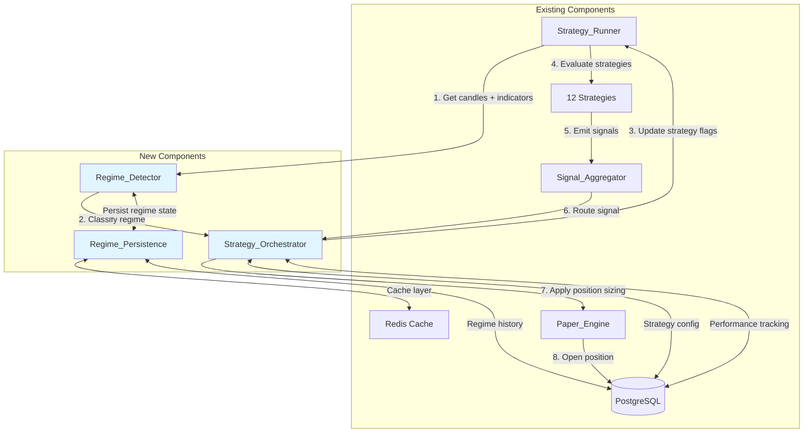
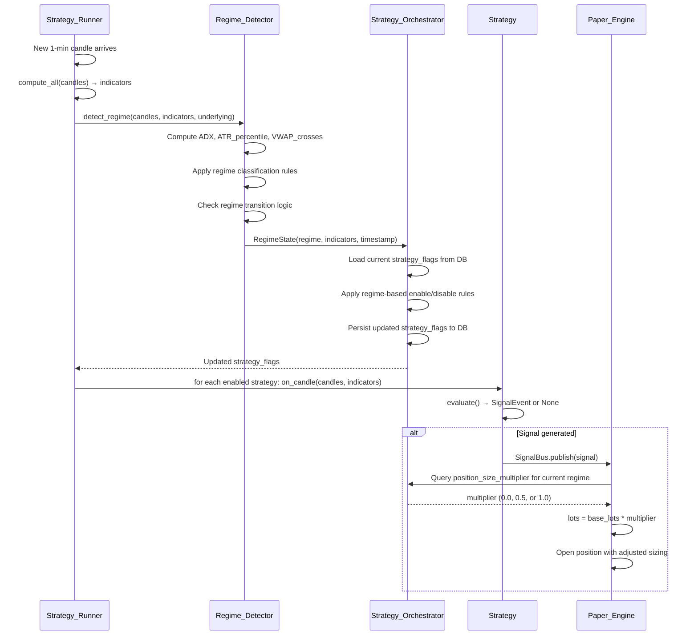

# Technical Design Document: Regime-Based Strategy Automation

## Overview

This document specifies the technical design for an automated regime detection and strategy orchestration system that integrates with the existing 12-strategy options trading system. The system consists of two primary components: a **Regime_Detector** that classifies market conditions in real-time, and a **Strategy_Orchestrator** that dynamically enables/disables strategies and adjusts position sizing based on detected regimes.

### Design Goals

1. **Non-Invasive Integration**: Zero modifications to existing strategy logic — all control happens at the orchestration layer
2. **Real-Time Classification**: Regime detection completes within the 60-second candle processing window
3. **Deterministic Behavior**: Regime classification is unambiguous with clear priority rules for overlapping conditions
4. **Stateful Persistence**: Regime state survives system restarts without data loss
5. **Observable System**: Comprehensive logging and metrics for regime changes, strategy state transitions, and performance tracking

### System Context

The regime automation system sits between the existing **Strategy_Runner** (candle processing loop) and individual strategy implementations. It intercepts the candle processing flow to:

- Compute regime-specific indicators (ADX, ATR percentile, VWAP cross count)
- Classify the current market regime
- Update strategy enable/disable flags before strategy evaluation
- Apply position size multipliers when signals are generated
- Track regime-based performance metrics

## Architecture

### High-Level Component Diagram



### Data Flow Sequence



### Integration Points

| Component | Integration Method | Data Flow Direction |
|-----------|-------------------|---------------------|
| Strategy_Runner._run_underlying() | Call regime_detector.detect() before strategy loop | SR → RD |
| Strategy_Orchestrator | Update mode_manager.strategy_flags before strategies evaluate | RD → SO → SR |
| Paper_Engine.handle_signal() | Query orchestrator.get_position_multiplier() during lot sizing | PE → SO |
| Redis Cache | Store/retrieve regime state for each underlying | RD ↔ Redis |
| PostgreSQL | Persist regime history, performance metrics, config | SO ↔ DB |

## Component Design: Regime_Detector

### Responsibilities

1. Compute regime-specific technical indicators from candle data
2. Classify current market state into one of 9 defined regimes
3. Detect regime transitions and enforce transition cooldown
4. Persist regime state to Redis for fast access and restart recovery
5. Maintain regime history for transition detection

### Class Structure

```python
from dataclasses import dataclass
from datetime import datetime
from typing import Optional
import numpy as np

@dataclass
class RegimeIndicators:
    """Computed indicators used for regime classification."""
    adx: float
    atr: float
    atr_percentile: float
    vwap: float
    price: float
    vwap_cross_count: int
    volume: float
    avg_volume: float
    orb_high: Optional[float]
    orb_low: Optional[float]
    pdh: Optional[float]
    pdl: Optional[float]

@dataclass
class RegimeState:
    """Current regime classification and metadata."""
    regime: str  # One of 9 regime names
    underlying: str
    timestamp: datetime
    indicators: RegimeIndicators
    previous_regime: Optional[str] = None
    transition_cooldown_remaining: int = 0  # candles

class RegimeDetector:
    """Detects and classifies market regimes from candle data."""
    
    def __init__(self):
        self._regime_history: dict[str, list[RegimeState]] = {}  # underlying → last 5 states
        self._config: RegimeConfig = RegimeConfig()
        
    async def detect_regime(
        self,
        candles: list[dict],
        indicators: dict,
        underlying: str,
        is_expiry_day: bool = False
    ) -> RegimeState:
        """
        Main entry point: classify current regime from candle data.
        
        Args:
            candles: List of OHLCV dicts (newest last)
            indicators: Output from compute_all() 
            underlying: "NIFTY" or "BANKNIFTY"
            is_expiry_day: Whether today is option expiry for this underlying
            
        Returns:
            RegimeState with classification and supporting data
        """
        ...
```

### ADX Computation Algorithm

ADX (Average Directional Index) measures trend strength. The implementation uses the standard Wilder smoothing method:

```python
def compute_adx(high: np.ndarray, low: np.ndarray, close: np.ndarray, period: int = 14) -> float:
    """
    Compute ADX using Wilder's smoothing method.
    
    Algorithm:
    1. Calculate True Range (TR) for each candle
    2. Calculate +DM (positive directional movement) and -DM (negative)
    3. Smooth TR, +DM, -DM using 14-period EMA
    4. Calculate +DI = 100 * (smoothed +DM / smoothed TR)
    5. Calculate -DI = 100 * (smoothed -DM / smoothed TR)
    6. Calculate DX = 100 * |+DI - -DI| / (+DI + -DI)
    7. ADX = 14-period EMA of DX
    
    Minimum candles required: 28 (2× period for double smoothing)
    
    Returns:
        Latest ADX value as float, or None if insufficient data
    """
    if len(high) < period * 2:
        return None
        
    # Step 1: True Range
    prev_close = np.roll(close, 1)
    prev_close[0] = close[0]
    tr = np.maximum(high - low,
                    np.maximum(np.abs(high - prev_close),
                              np.abs(low - prev_close)))
    
    # Step 2: Directional Movement
    high_diff = np.diff(high, prepend=high[0])
    low_diff = -np.diff(low, prepend=low[0])
    
    plus_dm = np.where((high_diff > low_diff) & (high_diff > 0), high_diff, 0.0)
    minus_dm = np.where((low_diff > high_diff) & (low_diff > 0), low_diff, 0.0)
    
    # Step 3: Smooth using EMA
    def ema_wilder(arr, n):
        alpha = 1.0 / n
        result = np.empty_like(arr)
        result[:n] = np.nan
        result[n-1] = np.mean(arr[:n])
        for i in range(n, len(arr)):
            result[i] = alpha * arr[i] + (1 - alpha) * result[i-1]
        return result
    
    smoothed_tr = ema_wilder(tr, period)
    smoothed_plus_dm = ema_wilder(plus_dm, period)
    smoothed_minus_dm = ema_wilder(minus_dm, period)
    
    # Step 4 & 5: Directional Indicators
    with np.errstate(divide='ignore', invalid='ignore'):
        plus_di = 100 * smoothed_plus_dm / smoothed_tr
        minus_di = 100 * smoothed_minus_dm / smoothed_tr
    
    # Step 6: DX
    di_sum = plus_di + minus_di
    di_diff = np.abs(plus_di - minus_di)
    with np.errstate(divide='ignore', invalid='ignore'):
        dx = np.where(di_sum > 0, 100 * di_diff / di_sum, 0.0)
    
    # Step 7: ADX
    adx_line = ema_wilder(dx, period)
    
    # Return latest valid value
    valid = adx_line[~np.isnan(adx_line)]
    return float(valid[-1]) if len(valid) > 0 else None
```

### ATR Percentile Calculation

ATR percentile converts the current ATR into a 0-100 scale representing its position within the recent distribution:

```python
def compute_atr_percentile(atr_current: float, candles: list[dict], period: int = 20) -> float:
    """
    Calculate ATR percentile rank within the last 'period' candles.
    
    Algorithm:
    1. Compute ATR for each of the last 'period' candles
    2. Sort the ATR array
    3. Find the rank of current ATR in sorted array
    4. Percentile = (rank / period) * 100
    
    Args:
        atr_current: Current ATR value
        candles: List of OHLCV dicts (newest last)
        period: Rolling window size (default 20)
        
    Returns:
        Percentile value 0-100, or 50.0 if insufficient data
    """
    if len(candles) < period + 14:  # Need period + ATR computation window
        return 50.0  # Neutral default
        
    # Extract OHLC for ATR computation
    highs = np.array([c["high"] for c in candles[-(period+14):]])
    lows = np.array([c["low"] for c in candles[-(period+14):]])
    closes = np.array([c["close"] for c in candles[-(period+14):]])
    
    # Compute ATR for each candle in the window
    atr_values = []
    for i in range(14, len(highs)):
        window_high = highs[i-14:i+1]
        window_low = lows[i-14:i+1]
        window_close = closes[i-14:i+1]
        
        prev_close = np.roll(window_close, 1)
        prev_close[0] = window_close[0]
        tr = np.maximum(window_high - window_low,
                       np.maximum(np.abs(window_high - prev_close),
                                 np.abs(window_low - prev_close)))
        atr_val = np.mean(tr[-14:])  # Simple average for efficiency
        atr_values.append(atr_val)
    
    if not atr_values:
        return 50.0
        
    # Calculate percentile rank
    atr_array = np.array(atr_values)
    rank = np.sum(atr_array < atr_current)
    percentile = (rank / len(atr_array)) * 100
    
    return round(percentile, 1)
```

### VWAP Cross Count Algorithm

Counts how many times price crosses VWAP within a rolling window to detect choppy range-bound conditions:

```python
def compute_vwap_cross_count(candles: list[dict], vwap: float, window: int = 20) -> int:
    """
    Count VWAP crosses in the last 'window' candles.
    
    A cross occurs when close[i] and close[i-1] are on opposite sides of VWAP.
    
    Algorithm:
    1. Extract last 'window' candles
    2. For each candle i, compare close[i] vs VWAP and close[i-1] vs VWAP
    3. Cross detected if signs differ: (close[i] > VWAP) != (close[i-1] > VWAP)
    4. Return total count
    
    Args:
        candles: List of OHLCV dicts (newest last)
        vwap: Current VWAP value
        window: Rolling window size (default 20)
        
    Returns:
        Integer count of VWAP crosses
    """
    if len(candles) < window + 1:
        return 0
        
    closes = [float(c["close"]) for c in candles[-(window+1):]]
    
    cross_count = 0
    for i in range(1, len(closes)):
        prev_above = closes[i-1] > vwap
        curr_above = closes[i] > vwap
        if prev_above != curr_above:
            cross_count += 1
            
    return cross_count
```

### Regime Classification Priority Resolution

When multiple regime conditions are satisfied simultaneously, apply this priority order (highest to lowest):

```python
def classify_regime(
    indicators: RegimeIndicators,
    underlying: str,
    is_expiry_day: bool,
    previous_regime: Optional[str],
    config: RegimeConfig
) -> str:
    """
    Apply regime classification rules with deterministic priority resolution.
    
    Priority order (highest first):
    1. EXPIRY_DAY
    2. REGIME_TRANSITION
    3. HIGH_VOL_CHOP
    4. BREAKOUT_EVENT_BULLISH / BREAKOUT_EVENT_BEARISH
    5. BULL_TREND_NORMAL_VOL / BEAR_TREND_NORMAL_VOL
    6. TREND_HIGH_VOL
    7. LOW_VOL_COMPRESSION
    8. RANGE_NORMAL_VOL
    9. UNKNOWN (no conditions met)
    
    Returns:
        Regime name as string
    """
    # Priority 1: Expiry day overrides everything
    if is_expiry_day:
        return "EXPIRY_DAY"
    
    # Priority 2: Regime transition detection
    # (Checked by caller before classification — if transition detected,
    #  this function is not called for 3 candles)
    
    # Priority 3: High volatility chop
    if (indicators.atr_percentile > config.ATR_HIGH_PERCENTILE and
        indicators.vwap_cross_count >= config.VWAP_CROSS_CHOP_THRESHOLD):
        return "HIGH_VOL_CHOP"
    
    # Priority 4: Breakout events
    price = indicators.price
    vwap = indicators.vwap
    volume = indicators.volume
    avg_volume = indicators.avg_volume
    
    volume_surge = avg_volume > 0 and volume >= avg_volume * config.VOLUME_SURGE_MULTIPLIER
    
    orb_breakout_bull = (
        indicators.orb_high and price > indicators.orb_high and
        volume_surge and price > vwap
    )
    orb_breakout_bear = (
        indicators.orb_low and price < indicators.orb_low and
        volume_surge and price < vwap
    )
    pdh_breakout_bull = (
        indicators.pdh and price > indicators.pdh and
        volume_surge and price > vwap
    )
    pdl_breakout_bear = (
        indicators.pdl and price < indicators.pdl and
        volume_surge and price < vwap
    )
    
    if orb_breakout_bull or pdh_breakout_bull:
        return "BREAKOUT_EVENT_BULLISH"
    if orb_breakout_bear or pdl_breakout_bear:
        return "BREAKOUT_EVENT_BEARISH"
    
    # Priority 5: Bull/Bear trend normal volatility
    adx = indicators.adx
    atr_pct = indicators.atr_percentile
    
    if (adx > config.ADX_TREND_THRESHOLD and
        config.ATR_LOW_PERCENTILE <= atr_pct <= config.ATR_HIGH_PERCENTILE):
        if price > vwap:
            return "BULL_TREND_NORMAL_VOL"
        else:
            return "BEAR_TREND_NORMAL_VOL"
    
    # Priority 6: Trend high volatility
    if adx > config.ADX_TREND_THRESHOLD and atr_pct > config.ATR_HIGH_PERCENTILE:
        return "TREND_HIGH_VOL"
    
    # Priority 7: Low volatility compression
    vwap_proximity = abs(price - vwap) / vwap * 100
    if (atr_pct < config.ATR_LOW_PERCENTILE and
        vwap_proximity < config.VWAP_PROXIMITY_PERCENT):
        return "LOW_VOL_COMPRESSION"
    
    # Priority 8: Range normal volatility
    if (adx < config.ADX_RANGE_THRESHOLD and
        config.ATR_LOW_PERCENTILE <= atr_pct <= config.ATR_HIGH_PERCENTILE):
        return "RANGE_NORMAL_VOL"
    
    # Priority 9: No conditions met
    return "UNKNOWN"
```

### Regime Transition Detection

```python
def check_regime_transition(
    current_regime: str,
    regime_history: list[RegimeState],
    transition_window: int = 2
) -> bool:
    """
    Detect if regime has changed within the last 'transition_window' candles.
    
    Args:
        current_regime: Newly classified regime
        regime_history: List of previous RegimeState objects (newest last)
        transition_window: Number of candles to look back (default 2)
        
    Returns:
        True if regime changed within window, False otherwise
    """
    if len(regime_history) < transition_window:
        return False
        
    # Check if any of the last N regimes differ from current
    for state in regime_history[-transition_window:]:
        if state.regime != current_regime:
            return True
            
    return False
```

## Component Design: Strategy_Orchestrator

### Responsibilities

1. Translate regime state into strategy enable/disable actions
2. Determine position size multipliers based on regime
3. Filter signals by regime-specific direction constraints
4. Persist strategy configuration to database
5. Track regime-based performance metrics
6. Manage transition cooldown periods

### Class Structure

```python
from dataclasses import dataclass
from typing import Optional

@dataclass
class RegimeConfig:
    """Configuration thresholds for regime detection."""
    ADX_TREND_THRESHOLD: float = 22.0
    ADX_RANGE_THRESHOLD: float = 18.0
    ATR_LOW_PERCENTILE: float = 30.0
    ATR_HIGH_PERCENTILE: float = 70.0
    VWAP_PROXIMITY_PERCENT: float = 0.2
    VWAP_CROSS_CHOP_THRESHOLD: int = 8
    VOLUME_SURGE_MULTIPLIER: float = 1.5
    REGIME_TRANSITION_WINDOW: int = 2
    TRANSITION_COOLDOWN_CANDLES: int = 3

@dataclass
class StrategyControl:
    """Strategy enable/disable state for a specific regime."""
    enabled: bool
    allowed_directions: set[str]  # {"BUY", "SELL"} or subset
    position_size_multiplier: float  # 0.0, 0.5, or 1.0
    notes: str  # Reason for state

class StrategyOrchestrator:
    """Manages strategy states based on regime classification."""
    
    def __init__(self, regime_detector: RegimeDetector):
        self._regime_detector = regime_detector
        self._config = RegimeConfig()
        self._transition_cooldown: dict[str, int] = {}  # underlying → candles remaining
        
    async def on_regime_detected(
        self,
        regime_state: RegimeState
    ) -> dict[str, bool]:
        """
        Called by Strategy_Runner after regime detection.
        Updates strategy flags based on regime rules.
        
        Args:
            regime_state: Current regime classification
            
        Returns:
            Updated strategy_flags dict to be stored in mode_manager config
        """
        ...
        
    async def get_position_multiplier(self, underlying: str) -> float:
        """
        Query position size multiplier for current regime.
        
        Args:
            underlying: "NIFTY" or "BANKNIFTY"
            
        Returns:
            Multiplier value: 0.0 (no trade), 0.5 (half size), 1.0 (full size)
        """
        ...
        
    async def should_allow_signal(
        self,
        signal: SignalEvent,
        regime_state: RegimeState
    ) -> tuple[bool, str]:
        """
        Check if signal direction is permitted by current regime.
        
        Args:
            signal: Generated signal from strategy
            regime_state: Current regime classification
            
        Returns:
            (allowed: bool, reason: str)
        """
        ...
```

### Regime-to-Strategy Mapping

This table defines which strategies are enabled for each regime and the corresponding position sizing:

| Regime | Enabled Strategies | Allowed Directions | Position Multiplier | Notes |
|--------|-------------------|-------------------|---------------------|-------|
| BULL_TREND_NORMAL_VOL | VWAP_PULLBACK | BUY only | 1.0 | CE trades in confirmed uptrend |
| BEAR_TREND_NORMAL_VOL | VWAP_PULLBACK | SELL only | 1.0 | PE trades in confirmed downtrend |
| TREND_HIGH_VOL | VWAP_PULLBACK | BUY if price>VWAP, SELL if price<VWAP | 0.5 | Reduced sizing for elevated risk |
| BREAKOUT_EVENT_BULLISH | ORB_VWAP | BUY only | 1.0 if ATR≤70%ile, 0.5 if ATR>70%ile | Volume-confirmed bullish breakout |
| BREAKOUT_EVENT_BEARISH | ORB_VWAP | SELL only | 1.0 if ATR≤70%ile, 0.5 if ATR>70%ile | Volume-confirmed bearish breakout |
| LOW_VOL_COMPRESSION | BOLLINGER_BREAKOUT | BUY, SELL | 1.0 | Await expansion move |
| RANGE_NORMAL_VOL | VWAP_REVERSAL | BUY, SELL | 1.0 | Mean-reversion in range |
| HIGH_VOL_CHOP | *NONE* | *NONE* | 0.0 | No trading — whipsaw conditions |
| REGIME_TRANSITION | *NONE* | *NONE* | 0.0 | No trading during instability |
| EXPIRY_DAY | *NONE* | *NONE* | 0.0 | No regime-based trading (let existing expiry guards handle) |
| UNKNOWN | *NONE* | *NONE* | 0.0 | Insufficient data or no match |

Implementation:

```python
# regime_rules.py
from typing import NamedTuple

class RegimeRule(NamedTuple):
    enabled_strategies: set[str]
    allowed_directions: set[str]
    position_multiplier: float
    notes: str

REGIME_RULES: dict[str, RegimeRule] = {
    "BULL_TREND_NORMAL_VOL": RegimeRule(
        enabled_strategies={"VWAP_PULLBACK"},
        allowed_directions={"BUY"},
        position_multiplier=1.0,
        notes="Confirmed uptrend with normal volatility — CE trades only"
    ),
    
    "BEAR_TREND_NORMAL_VOL": RegimeRule(
        enabled_strategies={"VWAP_PULLBACK"},
        allowed_directions={"SELL"},
        position_multiplier=1.0,
        notes="Confirmed downtrend with normal volatility — PE trades only"
    ),
    
    "TREND_HIGH_VOL": RegimeRule(
        enabled_strategies={"VWAP_PULLBACK"},
        allowed_directions={"BUY", "SELL"},  # Filtered by price vs VWAP at signal time
        position_multiplier=0.5,
        notes="Trending but elevated volatility — reduced position sizing"
    ),
    
    "BREAKOUT_EVENT_BULLISH": RegimeRule(
        enabled_strategies={"ORB_VWAP"},
        allowed_directions={"BUY"},
        position_multiplier=1.0,  # Adjusted to 0.5 if ATR_percentile > 70
        notes="Volume-confirmed bullish breakout"
    ),
    
    "BREAKOUT_EVENT_BEARISH": RegimeRule(
        enabled_strategies={"ORB_VWAP"},
        allowed_directions={"SELL"},
        position_multiplier=1.0,  # Adjusted to 0.5 if ATR_percentile > 70
        notes="Volume-confirmed bearish breakout"
    ),
    
    "LOW_VOL_COMPRESSION": RegimeRule(
        enabled_strategies={"BOLLINGER_BREAKOUT"},
        allowed_directions={"BUY", "SELL"},
        position_multiplier=1.0,
        notes="Low volatility compression — await expansion breakout"
    ),
    
    "RANGE_NORMAL_VOL": RegimeRule(
        enabled_strategies={"VWAP_REVERSAL"},
        allowed_directions={"BUY", "SELL"},
        position_multiplier=1.0,
        notes="Range-bound with normal volatility — mean-reversion trades"
    ),
    
    "HIGH_VOL_CHOP": RegimeRule(
        enabled_strategies=set(),
        allowed_directions=set(),
        position_multiplier=0.0,
        notes="High volatility chop — no trading to avoid whipsaws"
    ),
    
    "REGIME_TRANSITION": RegimeRule(
        enabled_strategies=set(),
        allowed_directions=set(),
        position_multiplier=0.0,
        notes="Regime transition detected — pause trading during instability"
    ),
    
    "EXPIRY_DAY": RegimeRule(
        enabled_strategies=set(),
        allowed_directions=set(),
        position_multiplier=0.0,
        notes="Option expiry day — let existing expiry guards handle (no regime trades)"
    ),
    
    "UNKNOWN": RegimeRule(
        enabled_strategies=set(),
        allowed_directions=set(),
        position_multiplier=0.0,
        notes="Regime classification failed — no trading"
    ),
}

def get_regime_rule(regime: str, atr_percentile: float = 50.0) -> RegimeRule:
    """
    Get regime rule with dynamic adjustments.
    
    Args:
        regime: Regime name
        atr_percentile: Current ATR percentile (for breakout sizing adjustment)
        
    Returns:
        RegimeRule with position multiplier adjusted if needed
    """
    rule = REGIME_RULES.get(regime, REGIME_RULES["UNKNOWN"])
    
    # Dynamic adjustment: reduce breakout sizing in high volatility
    if regime in {"BREAKOUT_EVENT_BULLISH", "BREAKOUT_EVENT_BEARISH"}:
        if atr_percentile > 70:
            rule = rule._replace(position_multiplier=0.5)
            
    return rule
```

## Data Models

### Redis Cache Structures

#### Regime State Cache

**Key Pattern**: `regime:{underlying}:current`

**TTL**: 600 seconds (10 minutes — survives brief restarts)

**Value Structure** (JSON):
```json
{
  "regime": "BULL_TREND_NORMAL_VOL",
  "underlying": "NIFTY",
  "timestamp": "2024-01-15T10:45:00+05:30",
  "indicators": {
    "adx": 28.5,
    "atr": 4.2,
    "atr_percentile": 65.0,
    "vwap": 21850.0,
    "price": 21865.0,
    "vwap_cross_count": 3,
    "volume": 125000,
    "avg_volume": 95000
  },
  "previous_regime": "LOW_VOL_COMPRESSION",
  "transition_cooldown_remaining": 0
}
```

#### Regime History Cache

**Key Pattern**: `regime:{underlying}:history`

**TTL**: 28800 seconds (8 hours — full trading session)

**Value Structure** (JSON array of last 5 regime states):
```json
[
  {
    "regime": "LOW_VOL_COMPRESSION",
    "timestamp": "2024-01-15T10:40:00+05:30",
    "candle_count": 85
  },
  {
    "regime": "BULL_TREND_NORMAL_VOL",
    "timestamp": "2024-01-15T10:45:00+05:30",
    "candle_count": 90
  }
]
```

### PostgreSQL Schema

#### Table: regime_states

Persists regime history for auditing and analysis.

```sql
CREATE TABLE regime_states (
    id SERIAL PRIMARY KEY,
    underlying VARCHAR(20) NOT NULL,
    regime VARCHAR(50) NOT NULL,
    timestamp TIMESTAMPTZ NOT NULL DEFAULT NOW(),
    
    -- Indicator snapshot
    adx DECIMAL(6,2),
    atr DECIMAL(8,2),
    atr_percentile DECIMAL(5,2),
    vwap DECIMAL(10,2),
    price DECIMAL(10,2),
    vwap_cross_count INTEGER,
    volume BIGINT,
    avg_volume DECIMAL(12,2),
    
    -- Metadata
    previous_regime VARCHAR(50),
    transition_detected BOOLEAN DEFAULT FALSE,
    
    CONSTRAINT regime_states_underlying_timestamp_key UNIQUE(underlying, timestamp)
);

CREATE INDEX idx_regime_states_underlying_timestamp ON regime_states(underlying, timestamp DESC);
CREATE INDEX idx_regime_states_regime ON regime_states(regime);
```

#### Table: regime_performance

Tracks profit/loss and win rate per regime.

```sql
CREATE TABLE regime_performance (
    id SERIAL PRIMARY KEY,
    regime VARCHAR(50) NOT NULL,
    underlying VARCHAR(20) NOT NULL,
    strategy_name VARCHAR(50) NOT NULL,
    
    -- Performance metrics
    total_trades INTEGER NOT NULL DEFAULT 0,
    winning_trades INTEGER NOT NULL DEFAULT 0,
    losing_trades INTEGER NOT NULL DEFAULT 0,
    total_pnl DECIMAL(12,2) NOT NULL DEFAULT 0,
    avg_pnl DECIMAL(10,2),
    win_rate DECIMAL(5,2),
    avg_rr DECIMAL(6,3),
    
    -- Timestamps
    first_trade_at TIMESTAMPTZ,
    last_trade_at TIMESTAMPTZ,
    updated_at TIMESTAMPTZ NOT NULL DEFAULT NOW(),
    
    CONSTRAINT regime_performance_unique UNIQUE(regime, underlying, strategy_name)
);

CREATE INDEX idx_regime_performance_regime ON regime_performance(regime);
CREATE INDEX idx_regime_performance_underlying ON regime_performance(underlying);
```

#### Table: regime_config

Stores tunable regime detection thresholds.

```sql
CREATE TABLE regime_config (
    id SERIAL PRIMARY KEY,
    underlying VARCHAR(20) NOT NULL,  -- NULL for global defaults
    
    -- ADX thresholds
    adx_trend_threshold DECIMAL(5,2) DEFAULT 22.0,
    adx_range_threshold DECIMAL(5,2) DEFAULT 18.0,
    
    -- ATR thresholds
    atr_low_percentile DECIMAL(5,2) DEFAULT 30.0,
    atr_high_percentile DECIMAL(5,2) DEFAULT 70.0,
    
    -- VWAP thresholds
    vwap_proximity_percent DECIMAL(5,3) DEFAULT 0.2,
    vwap_cross_chop_threshold INTEGER DEFAULT 8,
    
    -- Volume and transition
    volume_surge_multiplier DECIMAL(4,2) DEFAULT 1.5,
    regime_transition_window INTEGER DEFAULT 2,
    transition_cooldown_candles INTEGER DEFAULT 3,
    
    -- Metadata
    is_active BOOLEAN DEFAULT TRUE,
    created_at TIMESTAMPTZ NOT NULL DEFAULT NOW(),
    updated_at TIMESTAMPTZ NOT NULL DEFAULT NOW(),
    
    CONSTRAINT regime_config_underlying_key UNIQUE(underlying)
);

-- Seed global defaults
INSERT INTO regime_config (underlying) VALUES (NULL);
```

## Integration with Existing Code

### Integration Point 1: Strategy_Runner._run_underlying()

**Location**: `app/services/trading/strategy_runner.py:_run_underlying()`

**Current Flow**:
```python
async def _run_underlying(self, underlying: str, flags: dict):
    # ... fetch candles ...
    # ... compute indicators ...
    # ... ATR gate ...
    # ... VIX gate ...
    # ... expiry day check ...
    # ... inject OI/IV ...
    
    # Run strategies
    for strat in self._strategies.get(underlying, []):
        if not flags.get(strat.name, True):
            continue
        # ... expiry day SL check ...
        await strat.on_candle(candles, indicators)
```

**Modified Flow**:
```python
async def _run_underlying(self, underlying: str, flags: dict):
    # ... fetch candles ...
    # ... compute indicators ...
    # ... ATR gate ...
    # ... VIX gate ...
    
    # ★ NEW: Detect regime BEFORE expiry check
    regime_state = await regime_detector.detect_regime(
        candles=candles,
        indicators=indicators,
        underlying=underlying,
        is_expiry_day=is_expiry_day
    )
    
    # ★ NEW: Update strategy flags based on regime
    updated_flags = await strategy_orchestrator.on_regime_detected(regime_state)
    
    # ★ NEW: Merge with user-configured flags (user disable takes precedence)
    final_flags = {
        name: updated_flags.get(name, True) and flags.get(name, True)
        for name in self._strategies.get(underlying, {})
    }
    
    # ... inject OI/IV ...
    
    # Run strategies with regime-filtered flags
    for strat in self._strategies.get(underlying, []):
        if not final_flags.get(strat.name, True):
            continue
        # ... expiry day SL check ...
        
        # ★ NEW: Check transition cooldown
        if await strategy_orchestrator.is_in_cooldown(underlying):
            logger.debug(f"[{underlying}] Transition cooldown active — skipping {strat.name}")
            continue
            
        await strat.on_candle(candles, indicators)
```

### Integration Point 2: Paper_Engine.handle_signal()

**Location**: `app/services/trading/paper_engine.py:handle_signal()`

**Current Flow**:
```python
async def handle_signal(self, signal: SignalEvent) -> bool:
    # ... strategy enabled check ...
    # ... study phase check ...
    # ... pre-trade checks ...
    # ... option selection ...
    
    # ★ Current lot sizing
    trade_amount = await mode_manager.kelly_trade_amount(signal.strategy_name, cfg)
    lots, capital_used = _calc_lots(trade_amount, ltp, lot_size)
    lots = min(lots, cfg.max_lots_per_trade)
    
    # ... capital reservation ...
    # ... position opening ...
```

**Modified Flow**:
```python
async def handle_signal(self, signal: SignalEvent) -> bool:
    # ... strategy enabled check ...
    # ... study phase check ...
    
    # ★ NEW: Check regime allows this signal direction
    regime_state = await strategy_orchestrator.get_current_regime(signal.underlying)
    allowed, reason = await strategy_orchestrator.should_allow_signal(signal, regime_state)
    if not allowed:
        await self._save_signal(signal, SignalStatus.SKIPPED, reason=reason)
        logger.info(f"[PaperEngine] SKIPPED {signal.strategy_name}: {reason}")
        return False
    
    # ... pre-trade checks ...
    # ... option selection ...
    
    # ★ NEW: Apply regime-based position sizing
    base_trade_amount = await mode_manager.kelly_trade_amount(signal.strategy_name, cfg)
    position_multiplier = await strategy_orchestrator.get_position_multiplier(signal.underlying)
    
    if position_multiplier == 0.0:
        reason = f"Regime {regime_state.regime} does not permit trading"
        await self._save_signal(signal, SignalStatus.SKIPPED, reason=reason)
        return False
    
    regime_adjusted_amount = base_trade_amount * position_multiplier
    lots, capital_used = _calc_lots(regime_adjusted_amount, ltp, lot_size)
    lots = min(lots, cfg.max_lots_per_trade)
    
    logger.info(
        f"[PaperEngine] Regime={regime_state.regime} multiplier={position_multiplier} "
        f"base_amount=₹{base_trade_amount:.0f} adjusted=₹{regime_adjusted_amount:.0f} lots={lots}"
    )
    
    # ... capital reservation ...
    # ... position opening with regime metadata ...
```

### Integration Point 3: Paper_Engine Position Close

**Location**: `app/services/trading/paper_engine.py:_close_position()`

**Current Flow**:
```python
async def _close_position(self, pos_id: int, exit_price: float, reason: str):
    # ... calculate P&L ...
    # ... update position record ...
    # ... release capital ...
    # ... update daily P&L ...
```

**Modified Flow**:
```python
async def _close_position(self, pos_id: int, exit_price: float, reason: str):
    # ... calculate P&L ...
    # ... update position record ...
    
    # ★ NEW: Record regime performance
    async with AsyncSessionLocal() as db:
        # Fetch the regime that was active when position opened
        result = await db.execute(
            select(PaperPosition.entry_regime, PaperPosition.strategy_name)
            .where(PaperPosition.id == pos_id)
        )
        row = result.one_or_none()
        if row and row.entry_regime:
            await strategy_orchestrator.record_trade_result(
                regime=row.entry_regime,
                underlying=pos.underlying,
                strategy_name=row.strategy_name,
                pnl=total_net,
                rr=trade_rr
            )
    
    # ... release capital ...
    # ... update daily P&L ...
```

**Schema Change**: Add `entry_regime` column to `paper_positions` table:

```sql
ALTER TABLE paper_positions ADD COLUMN entry_regime VARCHAR(50);
CREATE INDEX idx_paper_positions_entry_regime ON paper_positions(entry_regime);
```

## Testing Strategy

### Unit Tests

The design is highly modular with pure functions that can be tested in isolation:

**Priority Test Coverage**:

1. **ADX Computation** (`test_adx_computation.py`)
   - Known input/output validation against reference implementation
   - Edge cases: insufficient data, flat market, extreme volatility
   
2. **ATR Percentile** (`test_atr_percentile.py`)
   - Percentile rank validation with synthetic data
   - Window size variations
   
3. **VWAP Cross Count** (`test_vwap_cross_count.py`)
   - Zero crosses, single cross, multiple crosses
   - Window boundary conditions
   
4. **Regime Classification** (`test_regime_classification.py`)
   - Each of the 9 regime conditions in isolation
   - Priority resolution with overlapping conditions
   - Edge cases at threshold boundaries
   
5. **Regime Transition Detection** (`test_regime_transition.py`)
   - Stable regime (no transition)
   - Recent transition (within window)
   - Cooldown countdown

### Integration Tests

**Regime-to-Strategy Flow** (`test_regime_strategy_integration.py`):
- Mock candle data → regime detection → strategy flags updated → verify correct strategies enabled
- Test each regime's strategy mapping

**Position Sizing** (`test_position_sizing_integration.py`):
- Signal generated → regime multiplier applied → verify lot calculation
- Test all three multiplier values (0.0, 0.5, 1.0)

**Performance Tracking** (`test_regime_performance.py`):
- Open position with regime → close position → verify regime_performance table updated
- Aggregation correctness (win rate, avg P&L)

### Property-Based Tests

This design includes algorithmic indicator computations that are ideal candidates for property-based testing:

**Approach**: Not applicable for this feature. Regime detection is inherently stateful and depends on market data characteristics that don't have universal mathematical properties suitable for PBT. Integration tests with realistic market scenarios are more appropriate.

## Error Handling

### Graceful Degradation

When regime detection fails (insufficient data, computation errors), the system falls back to safe defaults:

```python
class RegimeDetector:
    async def detect_regime(self, candles, indicators, underlying, is_expiry_day):
        try:
            # ... regime detection logic ...
        except InsufficientDataError as e:
            logger.warning(f"[RegimeDetector] {underlying} insufficient data: {e}")
            return self._fallback_regime(underlying, "UNKNOWN")
        except Exception as e:
            logger.error(f"[RegimeDetector] {underlying} unexpected error: {e}", exc_info=True)
            return self._fallback_regime(underlying, "UNKNOWN")
    
    def _fallback_regime(self, underlying: str, regime: str) -> RegimeState:
        """Return safe UNKNOWN regime that disables all trading."""
        return RegimeState(
            regime=regime,
            underlying=underlying,
            timestamp=datetime.now(timezone.utc),
            indicators=RegimeIndicators(
                adx=0, atr=0, atr_percentile=50, vwap=0, price=0,
                vwap_cross_count=0, volume=0, avg_volume=0,
                orb_high=None, orb_low=None, pdh=None, pdl=None
            ),
            transition_cooldown_remaining=0
        )
```

### Redis Failure Handling

If Redis is unavailable, regime state cannot be persisted, but detection continues in-memory:

```python
class RegimePersistence:
    async def save_regime_state(self, state: RegimeState):
        try:
            await redis_cache.set(
                f"regime:{state.underlying}:current",
                state.to_dict(),
                ttl=600
            )
        except RedisError as e:
            logger.error(f"Redis save failed for {state.underlying}: {e}")
            # Continue — in-memory state is still valid for this candle cycle
```

### Database Failure Handling

If Postgres writes fail, log the error but do not block trading:

```python
class StrategyOrchestrator:
    async def record_trade_result(self, regime, underlying, strategy_name, pnl, rr):
        try:
            async with AsyncSessionLocal() as db:
                # ... update regime_performance ...
                await db.commit()
        except DatabaseError as e:
            logger.error(f"Failed to record regime performance: {e}", exc_info=True)
            # Non-fatal — trading continues
```

## Performance Considerations

### Computation Overhead

Regime detection adds ~100-200ms to the 60-second candle processing loop:

- ADX computation: ~30ms (vectorized numpy operations on 60 candles)
- ATR percentile: ~20ms (20-candle rolling window)
- VWAP cross count: ~10ms (simple iteration)
- Regime classification: ~5ms (conditional logic)
- Database persistence: ~50ms (async write to Postgres)
- Redis cache: ~10ms (async write)

**Total**: ~125ms per underlying per candle (well within 60-second budget)

### Optimization: Cached Indicator Reuse

The existing `compute_all()` function already computes ATR, VWAP, EMA, etc. Regime detection reuses these values instead of recomputing:

```python
async def detect_regime(self, candles, indicators, underlying, is_expiry_day):
    # Reuse existing indicators
    atr_current = indicators.get("atr")
    vwap_current = indicators.get("vwap")
    close_current = indicators.get("close")
    
    # Only compute new regime-specific indicators
    adx = self._compute_adx_if_needed(candles)
    atr_percentile = self._compute_atr_percentile(atr_current, candles)
    vwap_cross_count = self._compute_vwap_cross_count(candles, vwap_current)
    
    # ... classification ...
```

### Memory Footprint

- Regime history: 5 states × 2 underlyings × ~500 bytes = ~5 KB in memory
- Redis cache: ~2 KB per underlying (current state + history)
- Database: ~1 KB per regime state row (grows over time but indexed for fast queries)

## API Contracts

### RegimeDetector API

```python
class RegimeDetector:
    """Public interface for regime detection."""
    
    async def detect_regime(
        self,
        candles: list[dict],
        indicators: dict,
        underlying: str,
        is_expiry_day: bool = False
    ) -> RegimeState:
        """
        Classify current market regime.
        
        Args:
            candles: List of OHLCV dicts (newest last), minimum 28 candles for ADX
            indicators: Output from compute_all(candles)
            underlying: "NIFTY" or "BANKNIFTY"
            is_expiry_day: True if today is option expiry for this underlying
            
        Returns:
            RegimeState with classification and indicators
            
        Raises:
            InsufficientDataError: If candles < 28 (ADX needs 2× 14-period window)
        """
        
    async def get_current_regime(self, underlying: str) -> Optional[RegimeState]:
        """
        Retrieve cached current regime without recomputing.
        
        Args:
            underlying: "NIFTY" or "BANKNIFTY"
            
        Returns:
            Cached RegimeState or None if not available
        """
        
    async def get_regime_history(self, underlying: str, limit: int = 5) -> list[RegimeState]:
        """
        Retrieve recent regime history.
        
        Args:
            underlying: "NIFTY" or "BANKNIFTY"
            limit: Maximum number of states to return (newest first)
            
        Returns:
            List of RegimeState objects
        """
```

### StrategyOrchestrator API

```python
class StrategyOrchestrator:
    """Public interface for strategy control."""
    
    async def on_regime_detected(self, regime_state: RegimeState) -> dict[str, bool]:
        """
        Update strategy flags based on regime.
        
        Args:
            regime_state: Current regime classification
            
        Returns:
            Dict mapping strategy names to enabled status
            Example: {"VWAP_PULLBACK": True, "ORB_VWAP": False, ...}
        """
        
    async def get_position_multiplier(self, underlying: str) -> float:
        """
        Get position size multiplier for current regime.
        
        Args:
            underlying: "NIFTY" or "BANKNIFTY"
            
        Returns:
            Float value: 0.0 (no trade), 0.5 (half size), 1.0 (full size)
        """
        
    async def should_allow_signal(
        self,
        signal: SignalEvent,
        regime_state: RegimeState
    ) -> tuple[bool, str]:
        """
        Check if signal direction is permitted by regime rules.
        
        Args:
            signal: Generated signal from strategy
            regime_state: Current regime classification
            
        Returns:
            Tuple of (allowed: bool, reason: str)
            Example: (False, "BULL_TREND_NORMAL_VOL allows BUY only, signal was SELL")
        """
        
    async def is_in_cooldown(self, underlying: str) -> bool:
        """
        Check if transition cooldown is active for underlying.
        
        Args:
            underlying: "NIFTY" or "BANKNIFTY"
            
        Returns:
            True if cooldown active (block all signals), False otherwise
        """
        
    async def record_trade_result(
        self,
        regime: str,
        underlying: str,
        strategy_name: str,
        pnl: float,
        rr: Optional[float] = None
    ):
        """
        Record trade result for regime performance tracking.
        
        Args:
            regime: Regime name when position was opened
            underlying: "NIFTY" or "BANKNIFTY"
            strategy_name: Strategy that generated the signal
            pnl: Net profit/loss after brokerage
            rr: Achieved risk-reward ratio (optional)
        """
```

## Deployment and Rollout

### Phase 1: Shadow Mode (Week 1-2)

Deploy regime detection and orchestration logic but **do not modify strategy enable flags**. Log regime classifications and what actions would have been taken:

```python
# strategy_orchestrator.py
SHADOW_MODE = True  # Global flag

async def on_regime_detected(self, regime_state: RegimeState):
    updated_flags = self._compute_strategy_flags(regime_state)
    
    if SHADOW_MODE:
        logger.info(
            f"[SHADOW] Regime={regime_state.regime} "
            f"WOULD ENABLE: {[k for k, v in updated_flags.items() if v]} "
            f"WOULD DISABLE: {[k for k, v in updated_flags.items() if not v]}"
        )
        # Return unchanged flags — no actual control
        return await self._get_current_flags()
    else:
        # Production mode: apply regime control
        await self._persist_flags(updated_flags)
        return updated_flags
```

**Validation**: Compare shadow-mode logs against manual trading decisions. Verify regime classifications match visual chart analysis.

### Phase 2: Enabled Regimes Only (Week 3-4)

Flip `SHADOW_MODE = False` but only for regimes that strictly enable strategies (never disable):

- BULL_TREND_NORMAL_VOL
- BEAR_TREND_NORMAL_VOL
- LOW_VOL_COMPRESSION
- RANGE_NORMAL_VOL

Leave blocking regimes (HIGH_VOL_CHOP, REGIME_TRANSITION, EXPIRY_DAY) in shadow mode for another week.

**Validation**: Monitor win rates and drawdowns. Regime-based trades should show equal or better performance than baseline.

### Phase 3: Full Rollout (Week 5+)

Enable all regime rules including blocking conditions.

**Validation**: Compare daily P&L before/after regime automation. Track regime_performance table for each regime's profitability.

## Monitoring and Observability

### Key Metrics

1. **Regime Distribution**: Time spent in each regime per day
2. **Regime Transition Frequency**: How often regimes change (high frequency = unstable detection)
3. **Blocked Signals**: Count of signals suppressed by regime rules
4. **Regime-Based Win Rate**: Win rate per regime per strategy
5. **Position Sizing Impact**: Average lot size before/after regime multipliers

### Logging Standards

All regime-related log messages follow this format:

```
[RegimeDetector] {underlying} {regime} | ADX={adx:.1f} ATR%ile={atr_pct:.0f} VWAP_crosses={count}
[StrategyOrchestrator] {underlying} regime={regime} ENABLED=[{strategies}] multiplier={mult}
[StrategyOrchestrator] BLOCKED signal {strategy} {direction} — regime {regime} reason: {reason}
```

### Alerting

Set up alerts for:
- Regime detection failures (>5% of candles result in UNKNOWN)
- Regime transition frequency (>10 transitions per session = unstable)
- Redis cache misses for regime state (indicates persistence failure)

